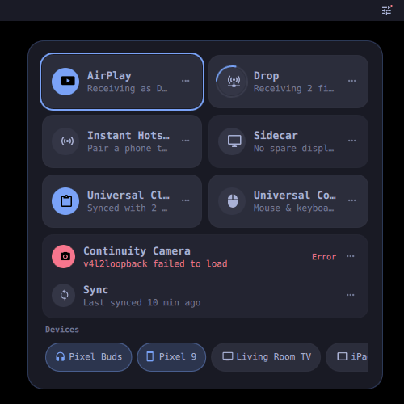
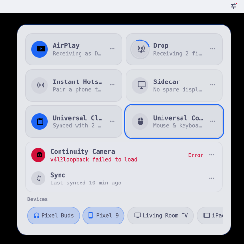
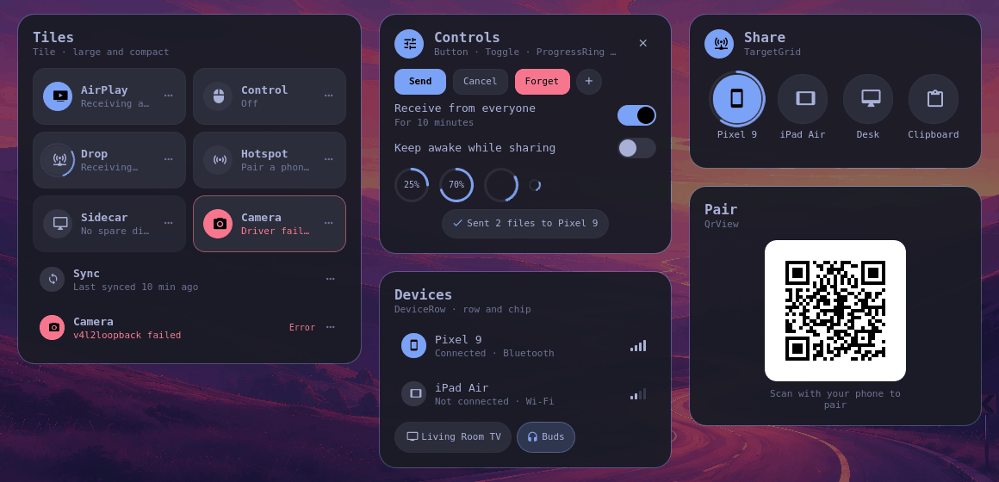
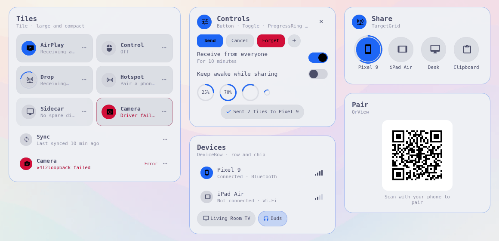
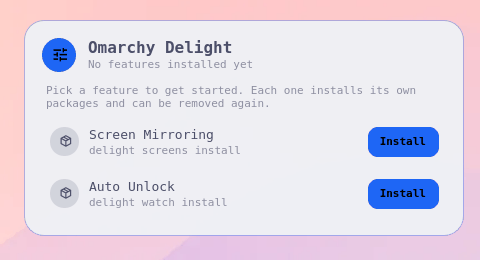

# Omarchy Delight design

Delight features should feel like one product, not a pile of daemons. This
page is the contract for how they look and behave: the principles, the
shared `qml/Delight` components every module builds its UI from, and a
do/don't list for module authors.

The Control Center (`plugins/control-center`, id `delight.control-center`)
is the reference implementation of everything below.

| Tokyo Night | Catppuccin Latte |
| --- | --- |
|  |  |

Captured from the live acceptance run (headless sway, real layer-shell panel,
`grim`) with the 8 fixture status files in
`plugins/control-center/tests/fixtures/status`.

## Principles

1. **One place.** Every feature shows up in the Control Center, driven only by
   its status JSON. Users never hunt through menus, tray icons or terminals
   to find out whether AirPlay is on. Rich UI lives in your own plugin and is
   reached from your tile's "…" action.
2. **One click.** The common action is a single click or key: the tile toggles
   (`delight <id> toggle`), "…" runs `actions[0]`, a share target sends.
   Anything that needs more than one decision belongs in a `Sheet`.
3. **Sensible defaults.** A fresh install should do the right thing without
   opening settings. Defaults live in `defaults.json`; the UI never asks a
   question it could answer itself (device name, port, discoverability).
4. **Graceful fallback.** Missing hardware or packages are a state, not a
   crash: report `unsupported` or `needs-setup` with a human `reason` and the
   Control Center shows it on the tile, dims it, and explains on click instead
   of toggling. No QML component assumes a tool exists (`QrView` falls back to
   text without `qrencode`; Tokens fall back without an Omarchy theme).
5. **Quiet notifications.** Status changes are shown in place (tile state,
   progress ring, a `Toast` inside your sheet). Desktop notifications are for
   things that happened while the user was not looking (a file arrived, a
   pairing request) and never for "it worked".

## Look and feel

- Colors, fonts, radius and spacing come from the active Omarchy theme via
  `Tokens` (which binds to `qs.Commons` `Color` and `Style`). Omarchy's theme
  switch calls `Color.loadColors()` + `Style.scheduleRefresh()`; every Delight
  surface restyles live, no restart. Verified by both test runs below.
- Surfaces are theme backgrounds with a slight foreground tint
  (`surface`, `surfaceRaised`, `surfacePressed`); one accent; `urgent` only for
  errors. Never hardcode a hex color.
- Motion is short (`animationFast` 120 ms, `animationNormal` 200 ms) and
  honours Omarchy's reduced-motion setting (`Tokens.reduceMotion` zeroes
  durations).
- Icons are Nerd Font glyphs in the theme font. Rounded, filled badges mark an
  "on" tile; a spinning ring marks `busy`.
- Everything is keyboard reachable: arrows/hjkl move, Space/Enter
  activates, "." or Shift+Enter opens details, Esc closes. Focus is drawn by
  `FocusRing` in the accent color.

## Control Center behavior

- **Bar icon** shows a dot when any module is `busy` (accent, pulsing) or
  `error` (urgent; wins over busy).
- **Large tiles** for statuses with `toggle: true`; **compact rows** for the
  rest. Sort order is the title, never a hardcoded id list.
- Tile click: `delight <id> toggle`. Disabled while `busy`; `unsupported`
  tiles show their reason in a toast instead of acting.
- "…": runs `actions[0].command`, otherwise `delight <id> open`.
- **Device strip** from `delight devices --json`; clicking a device runs
  `delight <module> open` for the module that reported it.
- **Empty state** (no status files): the uninstalled features from
  `delight list`, each with an Install button. With features installed, the
  same list is behind "Install features…".
- **Data:** watches `$XDG_RUNTIME_DIR/omarchy-delight/status/*.json`
  (new/removed/rewritten files apply immediately) and polls
  `delight status --json` every 30 s as a fallback. Files win over the poll.
- **Latency:** the panel is `keepLoaded`, so opening only flips visibility.
  Measured bar click to first panel frame: 54 ms cold, p95 94 ms over 20 runs.

## Component catalogue

Import with `import "Delight"` from your plugin (the installer bundles
`qml/Delight` into each plugin as `Delight/`). All components take their look
from `Tokens`.

| Tokyo Night | Catppuccin Latte |
| --- | --- |
|  |  |

| Component | Use it for | Key API |
| --- | --- | --- |
| `Tokens` (singleton) | Every color, size, font and duration | `foreground` `background` `accent` `urgent` `muted` `surface*` `border` `divider` `focusRing` `accentInk` `success` `warning`; `fontFamily` `fontSize*` `iconSize*`; `radius*` `spacing*` `padding*` `sheetWidth` `tileHeight` `space(px)` `rowHeight` `controlHeight`; `animationFast/Normal/Slow` `easing*` `reduceMotion` |
| `Tile` | A feature at a glance (Control Center) | `icon` `title` `subtitle` `status` `reason` `toggleable` `compact` `hasDetail` `detailLabel`; `toggled()` `detailRequested()` `explainRequested()` |
| `Sheet` | The card your rich UI lives in, with header and close | `title` `subtitle` `icon` `showClose` `closeOnEscape` `headerActions`; `closeRequested()`; children go in the body |
| `SheetWindow` | A centered modal `Sheet` on its own layer with scrim and Esc | `shown` `title` `subtitle` `icon` `sheetWidth` `dismissOnScrim` `sheet`; `closeRequested()` |
| `ListRow` | Settings and pick lists | `icon` `title` `subtitle` `interactive` `highlighted`; trailing children; `activated()` |
| `DeviceRow` | One device from a devices provider | `device` (`{name,kind,transport,connected,rssi}`), `orientation: "row" \| "chip"`, `busy`; `activated()` |
| `TargetGrid` | The share sheet's target picker | `targets` (`[{id,label,icon,kind}]`) `columns` `activeTargetId` `activeProgress` `emptyText`; `targetActivated(target)`; arrows/hjkl + Enter |
| `QrView` | Pairing codes | `text` or `source`, `caption`, `size`; text fallback without `qrencode` |
| `ProgressRing` / `Spinner` | Transfers and waits | `value` 0..1, `indeterminate`, `label`, `thickness` |
| `Toast` | Quiet in-place feedback | `show(message, glyph, kind)` with `info`/`success`/`error`; errors stay until replaced |
| `Button` | Actions | `text` `icon` `label` `variant: primary \| secondary \| plain \| destructive` `busy`; `clicked()` |
| `Toggle` | Boolean settings | `checked` `text` `description` `busy`; `toggled(checked)` (controlled: you set `checked`) |
| `Glyph`, `FocusRing` | Building blocks for custom controls | `glyph` `size` `color`; `FocusRing` fills its parent and shows on `activeFocus` |

Phase 0 API (`Tokens`, `Tile`, `Sheet` and their existing properties) is
frozen: components and properties can be added, never renamed or removed.

## Do / don't for module authors

**Do**

- Write status on every change with `delight_status_write`; set `toggle: true`
  only if `delight <id> toggle` really flips the feature.
- Put a human `reason` on `unsupported`, `error` and `needs-setup` ("No spare
  display output on this GPU", not "exit 2").
- Keep `subtitle` short and specific ("Receiving as Desk", "2 devices").
- Make `actions[0]` the thing most people want from "…", usually opening your
  sheet via `delight ui summon delight.<id>`.
- Build sheets from `Sheet`/`SheetWindow`, `ListRow`, `Toggle`, `Button` and
  `Tokens`, and support Esc, Tab and Enter.
- Report devices through `devices --json` so they appear in the strip.
- Check both a dark and a light theme (Tokyo Night and Catppuccin Latte) and
  switch themes with your sheet open.

**Don't**

- Edit `plugins/control-center` or add a second bar icon for your feature.
- Hardcode colors, fonts, sizes or durations, or bundle your own icon font.
- Use `error` for "not configured yet" (that is `needs-setup`) or `busy` for
  more than a transition.
- Send a desktop notification for every state change, or a modal for
  something a toast can say.
- Assume Hyprland-only protocols, a GPU, or optional tools exist; degrade
  instead.
- Block the UI on a slow command: run it, show `busy`, and let the status file
  update the tile.

## Tests

- `plugins/control-center/tests/render-test.sh` (CI, offscreen Quickshell):
  renders the panel and bar from the 8 fixtures, covers every state value,
  drives it with key events against a stubbed `delight`, checks live status
  file updates and a live theme switch, and writes the catalogue screenshots.
- `plugins/control-center/acceptance/live.sh` (VM): real layer-shell panel on
  headless sway; measures bar click to first frame over 20 runs, real
  keystrokes via `wtype`, live theme switch, `grim` screenshots.
